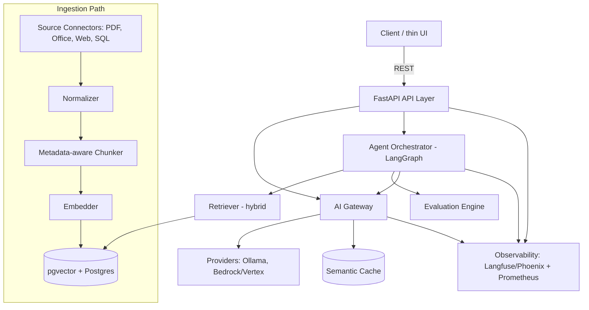
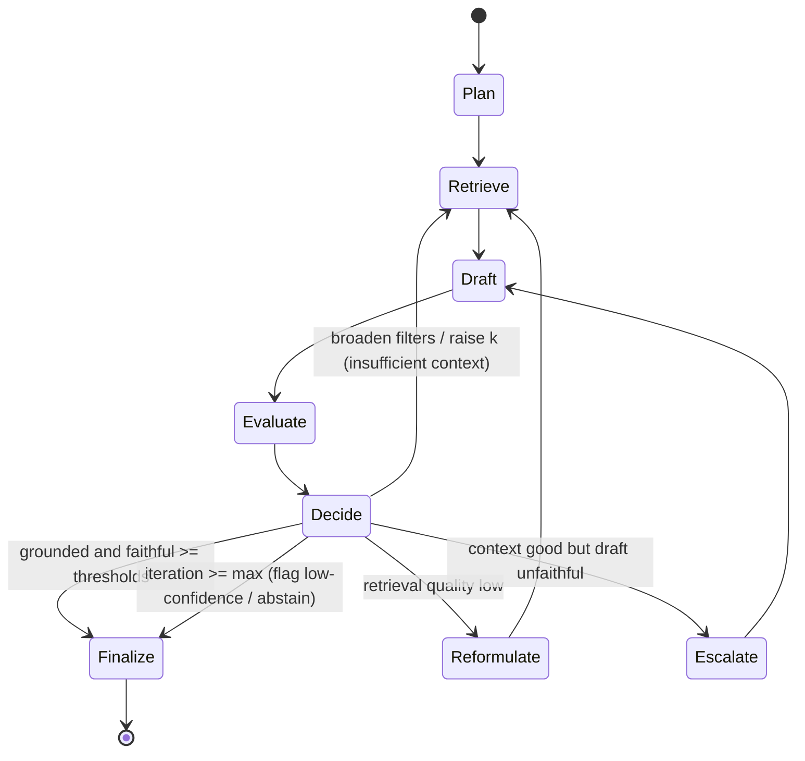

# GroundControl

**A self-correcting agentic RAG platform where evaluation metrics are runtime control signals, not post-hoc analytics.**

Most RAG systems score answers after the fact, in a notebook, days after users saw them. GroundControl scores every answer *before* it leaves the building: the same faithfulness/groundedness metrics that grade the system offline also gate every response at request time. A draft that isn't grounded in retrieved evidence doesn't get returned — it triggers query reformulation, broader retrieval, or model escalation, in a bounded agentic loop, until it either passes or the system honestly flags low confidence.

Built as a production-shaped reference implementation: typed async FastAPI service, Postgres/pgvector as the single source of truth, a LangGraph state machine driving self-correction, a provider-agnostic AI gateway with routing/fallback/semantic caching, full request tracing, and a Dockerized, CI-tested deploy — all running at effectively $0 with local models, with one cloud adapter behind a hard token cap for a real cloud-platform claim.

---

## Why this exists

Evaluation frameworks for RAG (Ragas, faithfulness/groundedness/context-precision scoring) are usually treated as an offline benchmarking concern — a report generated after deployment. GroundControl's central bet is that the same metric definitions are cheap and fast enough to run *online*, per request, and can therefore be wired directly into the control flow of the agent: **evaluate → decide → remediate**, not **respond → hope**. That closed loop, and the discipline of building it on production-grade infrastructure (ACID ingestion, provider fallback, full observability) rather than a notebook, is the point of the project.

## Architecture



**Query path:** `POST /query` → gateway checks the semantic cache → on a miss, the agent orchestrator runs plan → retrieve → draft → evaluate → decide, escalating or re-retrieving as needed within a bounded iteration budget → the response carries the answer, citations, confidence, and the metrics that produced it → a full trace is emitted to observability.

**Ingestion path:** a source connector fetches raw documents → a normalizer produces a canonical document → a metadata-aware chunker splits it with structure preserved (tables, headings) → an embedder vectorizes the chunks → a transactional upsert into pgvector, keyed by content hash, makes ingestion idempotent → hybrid indexes (vector + full-text) are built.

### The agent state machine



`AgentState` carries `query, plan, filters, retrieved_context, draft_answer, eval_result, iteration, max_iterations, model_tier, cost_accum, trace_id, decision`. The decision rule: if groundedness and faithfulness clear their thresholds, finalize; if iterations are exhausted, finalize with a low-confidence flag (or abstain); otherwise diagnose and remediate — low context precision reformulates the query, insufficient context broadens filters or raises `k`, and a grounded-but-unfaithful draft escalates the model tier or re-drafts under a stricter prompt. Thresholds and `max_iterations` are configuration, not code.

### Design posture

Every cross-cutting capability — source connector, chunker, embedder, vector store, retriever, LLM provider, evaluator — is a `Protocol` with concrete implementations injected in (`app/core/interfaces.py`). New sources, providers, or metrics are additions, not edits, and every collaborator can be swapped for a fake in tests. Interfaces are split by concern: a `Chunker` never sees provider credentials; an `Evaluator` never touches the vector store.

## Technology (cost-optimized, local-first)

| Concern | Choice | Rationale |
|---|---|---|
| Language / API | Python 3.11, FastAPI, Pydantic v2 | Async, typed contracts |
| Store | Postgres + `pgvector` | One store for vectors, relational data, and cache; ACID |
| Embeddings | `sentence-transformers` (bge-small) | Local, $0 |
| LLM (dev) | Ollama (llama3.1 / qwen2.5) | Local, $0 development and online judge |
| LLM (cloud) | one adapter: AWS Bedrock or Vertex AI | Real cloud-platform claim, capped by token accounting |
| Orchestration | LangGraph | State-machine agent |
| Evaluation | Ragas + custom metrics; Promptfoo (optional) | Faithfulness, groundedness, context precision/recall |
| Observability | Langfuse (self-host) or Arize Phoenix + Prometheus | Traces, token/cost/latency, dashboards |
| Cache / queue | Redis (semantic cache + background jobs via ARQ) | |
| Deploy / CI | Docker Compose, GitHub Actions | Reproducible |

Baseline running cost is effectively **$0**; the cloud adapter runs on trial credits behind a hard token cap enforced by the gateway's token accountant.

### Non-functional targets

- **Latency:** cache hit < 100 ms; cold agentic path bounded by `max_iterations × (retrieve + draft + judge)`, default `max_iterations = 3`.
- **Reliability:** gateway fallback chain across providers, retries with exponential backoff, per-provider circuit breaker.
- **Cost:** semantic cache, local models for embeddings and the online judge, per-request token accounting.
- **Data integrity:** per-document ingestion is one transaction, idempotent by `content_hash`; request traces and eval results are written atomically.

## API

- `POST /ingest {source_type, config}` → `{job_id}` (async via an ARQ worker) · `GET /ingest/{job_id}` → status.
- `POST /query {question, filters?, options?}` → `{answer, citations[], confidence, faithfulness, groundedness, iterations, cost_usd, latency_ms, cache_hit, trace_id}`.
- `POST /eval/run {dataset_id, config}` → `{eval_run_id}` · `GET /eval/run/{id}` → aggregate metrics.
- `GET /healthz`, `GET /readyz`, `GET /metrics` (Prometheus exposition).

## Observability

- **Structured logs** (`structlog`, JSON-rendered): every HTTP request logs method/path/status/duration; `trace_id` ties a served query to its `requests` row.
- **Prometheus** at `GET /metrics`: `groundcontrol_query_latency_seconds`, `groundcontrol_query_iterations`, `groundcontrol_query_cost_usd_total`, `groundcontrol_query_cache_hits_total`, `groundcontrol_query_low_confidence_total`, `groundcontrol_gateway_provider_calls_total{provider,task,outcome}`, `groundcontrol_eval_score{metric}`.
- **Langfuse** tracing is opt-in: set `LANGFUSE_PUBLIC_KEY`/`LANGFUSE_SECRET_KEY` and the agent loop emits a span per run; unset, it's a zero-cost no-op — the service behaves identically either way.
- **CI** builds the Docker image and smoke-tests `GET /healthz` against a running container on every push, in addition to lint + unit tests.

## Data model

| Table | Purpose |
|---|---|
| `documents` | Source-of-record per ingested document, unique on `content_hash` for idempotent re-ingest |
| `chunks` | Chunk text, metadata, `vector` embedding (HNSW index) and `tsvector` (GIN index) for hybrid search |
| `requests` | One row per served query — model path, iterations, metrics, cost, latency, cache outcome |
| `eval_runs` / `eval_results` | Offline benchmark headers and per-sample scores |
| `cache` | Semantic cache: prompt embedding, stored response, namespace version for invalidation on corpus change |

## Getting started

```bash
git clone https://github.com/harshrawat-14/GroundControl.git
cd GroundControl
cp .env.example .env          # fill in a cloud provider key only if you want the cloud tier
docker compose up -d          # Postgres+pgvector, Redis, Ollama, Langfuse, api, worker
docker compose exec ollama ollama pull llama3.1

curl http://localhost:8000/healthz

curl -X POST http://localhost:8000/ingest \
  -H "content-type: application/json" \
  -d '{"source_type": "pdf", "config": {"path": "samples/handbook.pdf"}}'

curl -X POST http://localhost:8000/query \
  -H "content-type: application/json" \
  -d '{"question": "What is the refund policy for enterprise contracts?"}'
```

Local development without Docker:

```bash
pip install -e ".[dev]"
pytest tests/unit
uvicorn app.main:app --reload
```

## Project layout

```
app/
  api/routes/        FastAPI routers (health, ingest, query, eval)
  core/               config, Protocol interfaces, shared Pydantic schemas
  db/                 SQLAlchemy models, async session
  ingestion/          connectors, normalizer, chunker, ARQ worker
  retrieval/          hybrid retriever (vector + BM25 + optional rerank)
  orchestrator/       LangGraph agent state machine
  evaluation/         Ragas-backed evaluators, composite evaluator, online judge
  gateway/            routing policy, provider adapters, semantic cache, token accountant
infra/docker/         Dockerfile
.github/workflows/    CI (lint + unit tests)
tests/                unit and integration tests
```

## Build plan and status

Built as six milestones, each ending in a conventional commit; milestones M1–M5 each demonstrate one resume-worthy capability once its acceptance criteria pass.

| Milestone | Delivers | Status |
|---|---|---|
| M0 — Scaffold and infra | Repo, Docker Compose stack, FastAPI skeleton, health checks, CI | ✅ |
| M1 — Ingestion + retrieval + `/query` | PDF/Web connectors, metadata-aware chunker, hybrid retrieval, grounded cited answers | ✅ |
| M2 — Agentic self-correction loop | LangGraph state machine, online judge, bounded re-retrieval/escalation | ✅ |
| M3 — Evaluation framework | Ragas-style metrics, golden dataset, `/eval/run`, same metric reused as the runtime gate | ✅ |
| M4 — AI gateway | Routing policy, fallback chain, semantic cache, token accounting, one cloud adapter | ✅ |
| M5 — Observability + deploy hardening | Structured logs, Prometheus metrics, optional Langfuse tracing, CI Docker build+smoke-test | ✅ |

See [`docs/GroundControl_Design.md`](docs/GroundControl_Design.md) for the full design document (HLD, LLD, and the detailed per-milestone acceptance criteria and risk register this build follows).

## Testing

- **Unit:** chunker invariants, routing policy, cache hit/miss, each evaluator in isolation.
- **Integration:** ingest → retrieve → answer against a local model with fixed seeds.
- **API contract tests** against the FastAPI schema.
- **Golden-set eval regression** run in CI to catch quality regressions, not just crashes.

## Guardrails

Input validation on every endpoint, a prompt-injection heuristic over retrieved content before it reaches the draft prompt, grounded-only output enforcement (the agent loop itself), API-key auth, and secrets sourced from the environment only — nothing sensitive is ever committed.

## License

MIT — see [LICENSE](LICENSE).
