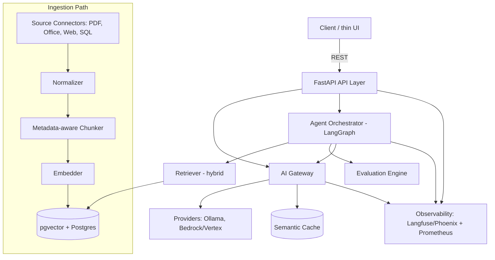
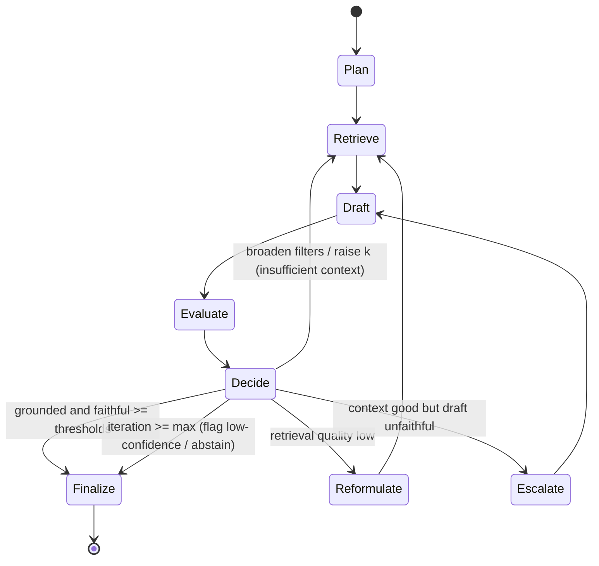

# GroundControl — Design Document

**Self-Correcting Agentic RAG Platform**
Author: Harsh Rawat · Status: Design (pre-build) · Target: production-grade portfolio project

GroundControl is an agentic Retrieval-Augmented Generation service whose distinguishing idea is that **evaluation metrics are runtime control signals, not post-hoc analytics**. The same faithfulness/groundedness scores that grade the system offline also gate every answer at request time: a draft that isn't grounded in retrieved evidence triggers query reformulation, re-retrieval, or model escalation before anything is returned.

This document is the build contract. It is split into High-Level Design, Low-Level Design, and a phased Master Plan in which each milestone earns one resume bullet only after it demonstrably works.

---

## 1. High-Level Design (HLD)

### 1.1 Goals and non-goals

Goals: production-shaped RAG (ingest → retrieve → answer) over heterogeneous enterprise sources; an agentic self-correction loop; an automated evaluation framework reused as a runtime gate; a provider-agnostic AI gateway with routing, fallback, and semantic caching; end-to-end observability; containerized deploy with CI/CD.

Non-goals (v1): multi-tenant SaaS, fine-tuning (stretch), a rich frontend (a thin demo UI only), horizontal autoscaling beyond a single node.

### 1.2 Component map



### 1.3 Query data flow

Client → `POST /query` → Gateway semantic-cache check → on miss, Agent Orchestrator runs the loop (plan → retrieve → draft → evaluate → decide) → answer plus citations, confidence, and metrics returned → full trace emitted to observability.

### 1.4 Ingestion data flow

Connector fetches raw documents → normalizer produces a canonical document → metadata-aware chunker splits with structure preserved (tables, headings) → embedder vectorizes → transactional upsert into pgvector keyed by content hash for idempotency → hybrid indexes (vector + full-text) built.

### 1.5 Technology choices (cost-optimized, local-first)

| Concern | Choice (v1 default) | Rationale |
|---|---|---|
| Language / API | Python 3.11, FastAPI, Pydantic v2 | Async, typed contracts, matches JD |
| Store | Postgres + `pgvector` (local Docker / Supabase free) | One store for vectors, relational data, and cache; ACID |
| Embeddings | `sentence-transformers` (bge-small / nomic) local | $0, no per-call cost |
| LLM (dev) | Ollama (llama3.1 / qwen2.5) local | $0 development and online eval judge |
| LLM (cloud) | one adapter: AWS Bedrock **or** Vertex AI | Real cloud-platform claim; free-tier/trial, capped |
| Orchestration | LangGraph | State-machine agent, satisfies agentic-framework requirement |
| Evaluation | Ragas + custom metrics; Promptfoo (optional A/B) | Faithfulness, groundedness, context precision/recall |
| Observability | Langfuse (self-host) or Arize Phoenix (OSS) + Prometheus | Traces, token/cost/latency, dashboards |
| Cache / queue | Redis (semantic cache + background jobs via ARQ) | Reuses your StrataExec task-queue pattern |
| Deploy / CI | Docker Compose, GitHub Actions | Reproducible, cloud-native-ready |

Baseline running cost is effectively **$0**; the cloud adapter uses trial credits with a hard token cap.

### 1.6 Non-functional targets

- Latency: cache hit < 100 ms; agentic cold path bounded by `max_iterations × (retrieve + draft + judge)`, capped (default `max_iterations = 3`).
- Reliability: gateway fallback chain, retries with exponential backoff, per-provider circuit breaker.
- Cost: semantic cache, local models for embeddings and the online judge, per-request token accounting.
- Data integrity (ACID): per-document ingestion runs in one transaction; idempotent by `content_hash`; request traces and eval results written atomically.

---

## 2. Low-Level Design (LLD)

### 2.1 SOLID posture

Every cross-cutting capability is a `Protocol` (interface); concrete implementations are injected. This keeps the pipeline **open for extension** (new source, embedder, provider, or metric) and **closed for modification**, and lets tests substitute fakes (Liskov). Interfaces are split by concern (Interface Segregation): a `Chunker` never sees provider credentials; an `Evaluator` never touches the vector store.

### 2.2 Core interfaces (signatures, not implementations)

```python
class SourceConnector(Protocol):
    def fetch(self) -> Iterable[RawDocument]: ...

class Chunker(Protocol):
    def chunk(self, doc: NormalizedDoc) -> list[Chunk]: ...

class Embedder(Protocol):
    def embed(self, texts: list[str]) -> list[Vector]: ...

class VectorStore(Protocol):
    def upsert(self, chunks: list[Chunk]) -> None: ...
    def search(self, qv: Vector, flt: Filter, k: int) -> list[ScoredChunk]: ...
    def delete(self, document_id: str) -> None: ...

class Retriever(Protocol):
    def retrieve(self, query: str, flt: Filter) -> RetrievedContext: ...

class LLMProvider(Protocol):
    def complete(self, req: LLMRequest) -> LLMResponse: ...

class Evaluator(Protocol):
    def evaluate(self, sample: EvalSample) -> EvalResult: ...
```

Implementations (v1): `PDFConnector`, `OfficeConnector`, `WebConnector`, `SQLConnector`; `RecursiveChunker`, `TableAwareChunker`; `LocalEmbedder`, `GatewayEmbedder`; `PgVectorStore`; `HybridRetriever` (vector + BM25 + optional rerank); `OllamaProvider`, `BedrockProvider`/`VertexProvider`; and `FaithfulnessEvaluator`, `GroundednessEvaluator`, `RelevanceEvaluator`, `CorrectnessEvaluator` composed by a `CompositeEvaluator`.

### 2.3 AI Gateway

The gateway is the single choke point for all model calls and owns three collaborators:

- `RoutingPolicy` (Strategy): `select(task, constraints) -> ordered[Provider]`. Routes by task (embed vs draft vs judge), cost ceiling, and latency budget; supports a cost/latency-tiered escalation ladder (local → cloud-small → cloud-large).
- `SemanticCache`: embed the prompt, search a cache table for cosine similarity ≥ threshold; on hit, return the stored response and mark `cache_hit`. TTL plus invalidation via a per-namespace `version` bumped on corpus change.
- `TokenAccountant`: records prompt/completion tokens, cost, latency, and provider per call.

Fallback: try providers in policy order; on error or timeout, advance the chain; open a circuit breaker per provider after repeated failures.

### 2.4 Agent state machine (the wow factor)



`AgentState` carries: `query, plan, filters, retrieved_context, draft_answer, eval_result, iteration, max_iterations, model_tier, cost_accum, trace_id, decision`.

Decision logic: if groundedness ≥ τ_g and faithfulness ≥ τ_f → finalize; else if iterations exhausted → finalize with a low-confidence flag (or abstain); else pick a remediation from the diagnosis — low context precision → reformulate query; insufficient context → broaden filters / raise `k`; grounded context but unfaithful draft → re-draft with a stricter prompt or escalate the model tier. Thresholds and `max_iterations` are configuration.

### 2.5 Evaluation as a runtime gate

Same metric definitions, two judge configurations. The **online** gate uses a cheap judge (local model plus embedding-overlap heuristics) to keep per-request latency and cost bounded. The **offline** benchmark uses a stronger judge for scoring accuracy. Metrics: faithfulness, groundedness, answer relevance, context precision/recall, correctness (offline, against a golden set), latency, and cost per request. This shared definition is what makes "eval as control signal" honest rather than a slogan.

### 2.6 Data model (Postgres)

| Table | Key columns | Notes |
|---|---|---|
| `documents` | id, source_type, source_uri, `content_hash` (unique), metadata jsonb, version, timestamps | Idempotent ingest by hash |
| `chunks` | id, document_id (fk cascade), ordinal, text, metadata jsonb, `embedding vector(d)`, `tsv tsvector` | HNSW/IVFFlat index on embedding; GIN on tsv |
| `requests` | id, trace_id, query, answer, model_path jsonb, iterations, faithfulness, groundedness, latency_ms, cost_usd, cache_hit, created_at | One row per served query |
| `eval_runs` | id, name, dataset, aggregate jsonb, created_at | Benchmark headers |
| `eval_results` | id, eval_run_id (fk), question, answer, metrics jsonb, passed | Per-sample results |
| `cache` | id, prompt_hash, `prompt_embedding vector(d)`, response jsonb, model, namespace_version, ttl, created_at | Semantic cache |

Integrity: foreign keys with cascade, `unique(content_hash)`, transactional per-document upsert, atomic trace/eval writes.

### 2.7 API contracts (FastAPI)

- `POST /ingest` `{source_type, config}` → `{job_id}` (async via ARQ worker); `GET /ingest/{job_id}` → status.
- `POST /query` `{question, filters?, options?}` → `{answer, citations[], confidence, faithfulness, groundedness, iterations, cost_usd, latency_ms, cache_hit, trace_id}`.
- `POST /eval/run` `{dataset_id, config}` → `{eval_run_id}`; `GET /eval/run/{id}` → aggregates.
- `GET /healthz`, `GET /readyz`, `GET /metrics` (Prometheus exposition).

### 2.8 Concurrency, testing, guardrails

Async FastAPI end to end; batched embeddings; pooled DB connections; background ingestion on a Redis/ARQ queue; bounded agent iterations to cap tail latency and cost. Tests: unit (chunker invariants, routing policy, cache hit/miss, each evaluator), integration (ingest → retrieve → answer on a local model with seeds), API contract tests, and a golden-set eval regression. Guardrails: input validation, a prompt-injection heuristic over retrieved content, grounded-only output enforcement, API-key auth, secrets via environment only.

---

## 3. Master Plan

Each milestone ends with a conventional commit and earns exactly one bullet **after acceptance passes**. Estimates assume evening/weekend pace and heavy reuse of your Graph-LLM RAG code.

### M0 — Scaffold and infra · ~0.5 day · (foundation, no bullet)
Repo, `docker-compose` (Postgres+pgvector, Redis, Langfuse, Ollama), FastAPI skeleton, health checks, CI running lint + tests.
Commit: `chore: scaffold service, compose stack, and CI`.

### M1 — Ingestion + retrieval + `/query` · ~1 weekend · **earns Bullet 1**
PDF + one more connector, metadata-aware chunker, local embedder, pgvector upsert, hybrid retrieval, grounded answer endpoint with citations.
**Acceptance:** ingest a sample corpus; `/query` returns a cited, grounded answer; ingest→retrieve→answer integration test green.
Commit: `feat: ingestion pipeline and grounded /query over pgvector`.

### M2 — Agentic self-correction loop · ~1 weekend · **earns Bullet 2**
LangGraph state machine, online evaluator (cheap judge), decision/remediation, bounded iterations.
**Acceptance:** an adversarial/underspecified question triggers at least one re-retrieval and terminates; measurable groundedness lift over single-pass on a small set.
Commit: `feat: closed-loop self-correction with eval-gated re-retrieval`.

### M3 — Evaluation framework (offline + online) · ~3–4 days · **earns Bullet 3**
Ragas + custom metrics, golden dataset, `/eval/run`, offline report, the same metric wired as the runtime gate, cost/latency capture.
**Acceptance:** an eval run yields aggregate faithfulness/groundedness/correctness/context metrics; a documented baseline-vs-agentic delta exists.
Commit: `feat: automated eval harness reused as runtime gate`.

### M4 — AI gateway (routing, fallback, semantic cache) · ~3–4 days · **earns Bullet 4**
Provider abstraction, routing policy, fallback chain, semantic cache, token accounting, one cloud adapter (Bedrock/Vertex).
**Acceptance:** cache-hit path < 100 ms; a forced provider failure falls back cleanly; token/cost logged; cache hit-rate measured.
Commit: `feat: multi-provider gateway with fallback and semantic cache`.

### M5 — Observability + deploy hardening · ~3–4 days · **earns Bullet 5**
Langfuse/Phoenix traces across nodes, Prometheus metrics, dashboards, alerts, Dockerized deploy, CI/CD, README + architecture diagram.
**Acceptance:** each request produces an end-to-end trace (retrieval, model path, tokens, cost, eval); container deploy reproducible; CI green.
Commit: `feat: end-to-end observability and CI/CD deployment`.

### M6+ — Stretch (optional, extra differentiation)
Domain fine-tune of a small embedder or LLM adapter (hits the JD "fine-tuning" line); online A/B evaluation; Kubernetes + infrastructure-as-code; richer frontend.

### 3.1 Risk register

| Risk | Mitigation |
|---|---|
| Agent loop inflates latency/cost | Hard `max_iterations`, cheap online judge, semantic cache, per-request cost cap |
| Judge model unreliable | Calibrate judge on the golden set; combine model score with embedding-overlap heuristics; pairwise checks |
| Scope creep | v1 cuts: single cloud adapter, reranker and fine-tuning deferred to stretch |
| Cloud cost surprise | Local-first defaults; cloud calls capped and behind the gateway's token accountant |

---

## 4. How this maps to the JD

Production RAG (ingestion, chunking, metadata, embeddings, vector DB, retrieval optimization) → M1. Agentic frameworks (LangGraph) → M2. Evaluation frameworks and quality metrics (faithfulness, groundedness, hallucination, correctness, latency, cost; offline + online) → M3. AI gateway, model routing, fallback, semantic/response caching, token optimization → M4. Observability and monitoring, LLMOps tooling (Langfuse/Phoenix), Docker, CI/CD, cloud platform adapter → M5. Fine-tuning → M6 stretch. The result is one system that touches the majority of the posting, with the eval-as-control-signal design as the senior-level talking point an interviewer will want to explore.
